# Wiki-Doc Classification

This project asks when visual information improves document classification enough to justify the extra computation. It grew out of a proof of concept on older, degraded scans, where pages that remained readable to a person could become hard for a model to classify. English WIKI-DOC provides a controlled setting for comparing OCR text, page images, and spatial layout before evaluating how those findings transfer to real scans.

LayoutXLM led both macro and weighted F1 across the four evaluated splits, but the size of its advantage varied. It also required more compute than DistilBERT in the recorded benchmark runs. That tradeoff motivates a text-first approach that adds visual processing selectively.

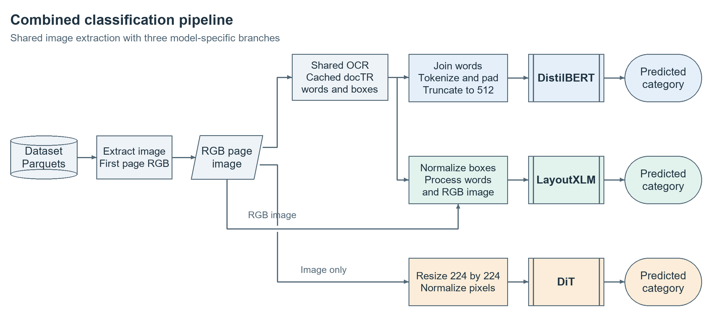

| Model | Inputs |
| --- | --- |
| DistilBERT | Text extracted with docTR |
| DiT | Page images |
| LayoutXLM | OCR text, token bounding boxes, and page images |

I built the reusable docTR OCR cache, implemented split checks, and trained and evaluated the three baselines.

This repository includes selected examples for OCR inspection and model evaluation, along with results and prediction exports from the original WIKI-DOC test split. The full training pipeline is currently kept private.

## Dataset and methodology

The experiments use the English WIKI-DOC subset of 217,866 documents across 110 classes, with 152,506 training, 32,680 validation, and 32,680 test documents. Each model uses the first page. I precomputed docTR OCR and cached the words, pixel-coordinate bounding boxes, and page dimensions so the text and multimodal runs could reuse the same OCR output.

DistilBERT reads the OCR words as a text sequence. LayoutXLM aligns OCR tokens with their bounding boxes and also receives the page image. Both models cap the text input at 512 tokens, so OCR text near the end of long pages can be dropped. DiT takes the RGB page resized to 224 × 224 pixels, which can make small text and fine visual details harder to distinguish.

### Experiment configuration

| Setting | DistilBERT | DiT | LayoutXLM |
| --- | --- | --- | --- |
| Pretrained checkpoint | `distilbert-base-multilingual-cased` | `microsoft/dit-base` | `microsoft/layoutxlm-base` |
| Input | Cached docTR text, up to 512 tokens | First-page RGB image resized to 224 × 224 | First-page RGB image and up to 512 OCR tokens with aligned bounding boxes |
| Maximum optimizer steps | 20,000 | 20,000 | 10,000 |
| Original-split training batch per device | 16 | 32 | 2 (8 gradient-accumulation steps) |
| Learning rate | 5 × 10⁻⁵ | 5 × 10⁻⁵ | 5 × 10⁻⁵ |
| Warmup and validation cadence | 300 warmup steps, validation every 300 steps | 300 warmup steps, validation every 300 steps | 300 warmup steps, validation every 300 steps |
| Training seed and checkpoint selection | 42, best validation macro F1 | 42, best validation macro F1 | 42, best validation macro F1 |

The experiments use `wiki-doc-en-merged` from the [Amazon Science dataset release](https://huggingface.co/datasets/AmazonScience/MultilingualMultiModalClassification). Fujinuma et al. (2023) introduced WIKI-DOC in [*A Multi-Modal Multilingual Benchmark for Document Image Classification*](https://cdn.amazon.science/b0/1f/5bb340bf41f9acd3ff144c2f8448/a-multi-modal-multilingual-benchmark-for-document-image-classification.pdf).

### Sample pages from English WIKI-DOC

These first-page renders come from the benchmark’s training partition. Each image links to its original export.

| Volcano | OfficeHolder | Newspaper |
| :---: | :---: | :---: |
| [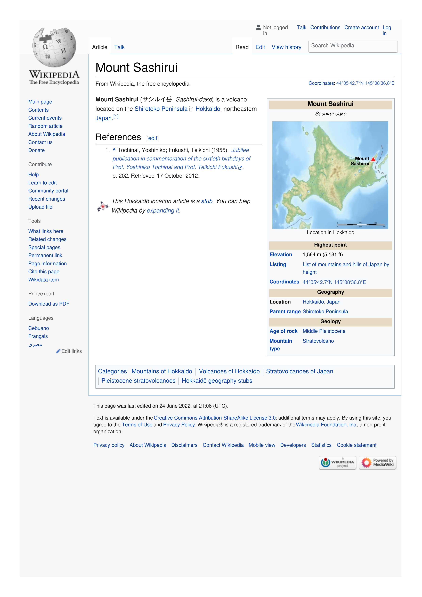](https://drive.google.com/file/d/1Aqbf0jhfqIQJsM0KBM5xg2MNfb8_tBIW/view?usp=drivesdk) | [](https://drive.google.com/file/d/1aoDw9dItyz-Dg9uhEND8lGqMnSvitTBX/view?usp=drivesdk) | [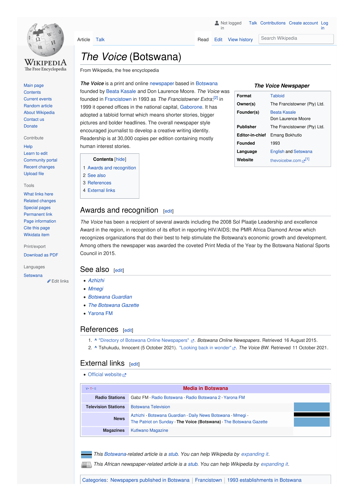](https://drive.google.com/file/d/1kZdkec6HoTmQ0AWGm4IdeqBd30pxeWAs/view?usp=drivesdk) |

### Repeated holdout protocol

For split seeds 42, 43, and 44, I pooled the original partitions, shuffled document positions within each class, and restored the original train, validation, and test counts for that class. The same saved assignments were used across models for each seed. Validation macro F1 guided checkpoint selection, and the test sets were held out for evaluation. Test documents can recur across repeats, so the split ranges describe observed sensitivity to document assignment.

## Preliminary results

Both tables report test F1 (%) on the original held-out split and three class-stratified repeated holdouts. The seed columns identify the data splits.

### Macro F1

Macro F1 gives each class equal weight.

| Model | Original split | Split seed 42 | Split seed 43 | Split seed 44 |
| --- | ---: | ---: | ---: | ---: |
| DistilBERT | 90.23 | 93.74 | 87.74 | 89.54 |
| DiT | 76.20 | 84.63 | 81.00 | 82.85 |
| LayoutXLM | 92.24 | 93.99 | 92.39 | 94.52 |

LayoutXLM scored highest on each evaluated split. Across the three repeated holdouts, the best-to-worst macro F1 spread was 2.13 percentage points for LayoutXLM, 3.63 for DiT, and 6.00 for DistilBERT. These are descriptive ranges across three splits. DistilBERT came within 0.25 percentage points of LayoutXLM on split seed 42.

### Weighted F1

Weighted F1 averages the per-class F1 scores, weighting each class by its number of examples in the test split.

| Model | Original split | Split seed 42 | Split seed 43 | Split seed 44 |
| --- | ---: | ---: | ---: | ---: |
| DistilBERT | 95.39 | 96.91 | 95.30 | 95.62 |
| DiT | 89.97 | 93.21 | 92.09 | 92.71 |
| LayoutXLM | 96.36 | 97.18 | 96.48 | 97.28 |

### Recorded runtime and compute on the original split

Experiments ran on Google Colab Pro+ using NVIDIA L4 and A100 GPUs. Compute costs are reported in Colab compute units (CU).

| Measurement | DistilBERT | DiT | LayoutXLM |
| --- | ---: | ---: | ---: |
| Test macro F1 | 90.23% | 76.20% | 92.24% |
| Shared OCR precompute | 2,319 min (L4) | N/A | 2,319 min (L4) |
| Training including validation | 185 min | 1,092 min | 1,685 min |
| Test evaluation and export | 9 min | 121 min | 143 min |
| GPU for training and evaluation | L4 | A100 | A100 |
| Compute units (CU) | 64.50 | 107.15 | 221.00 |

DistilBERT and LayoutXLM reused the same OCR cache. The OCR row shows the shared precompute time for each pipeline that used it. These are recorded runtimes on different GPUs, and the test timing includes export. At the time of these experiments, the hourly GPU rates were 1.54 CU/hour for the L4 and 5.30 CU/hour for the A100.

### Training curves and overall reliability

Expand each model to see its original Matplotlib figures for training and performance across splits.

<details>
<summary>DistilBERT</summary>

**Original split**

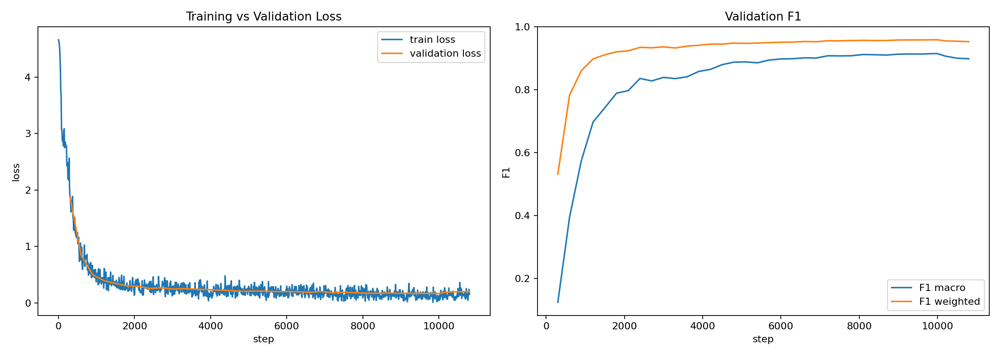

**Repeated holdouts (split seeds 42, 43, and 44)**

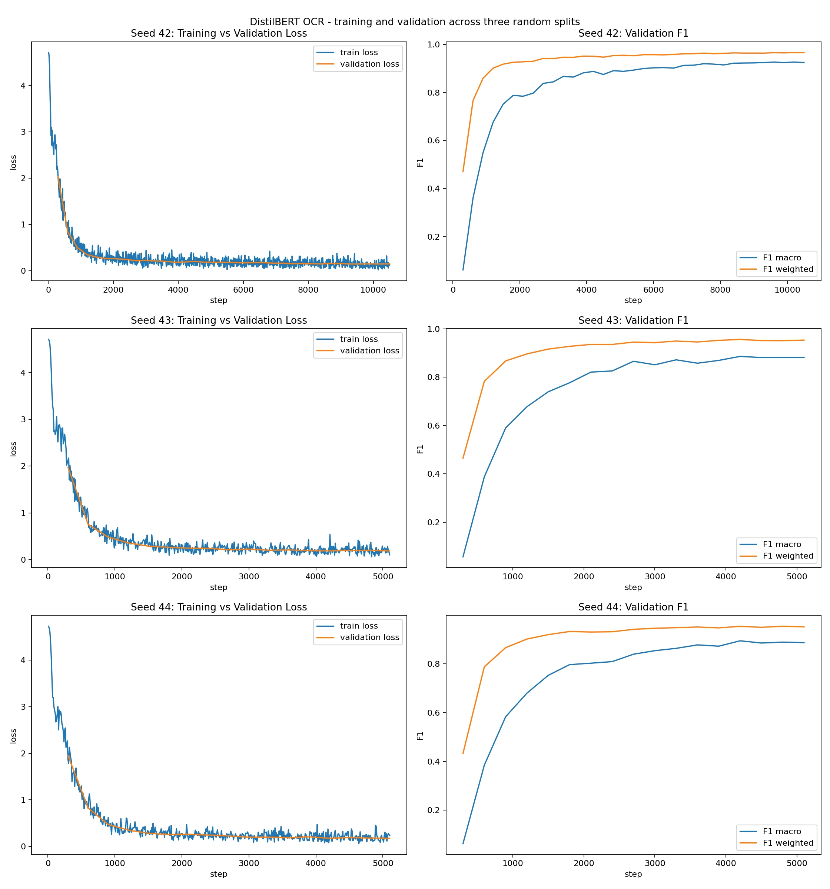

**Overall reliability**

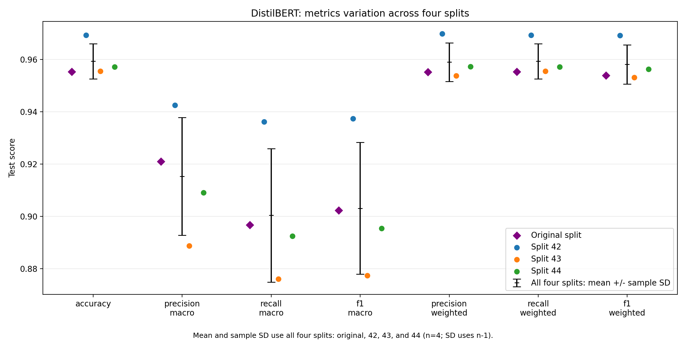

</details>

<details>
<summary>DiT</summary>

**Original split**

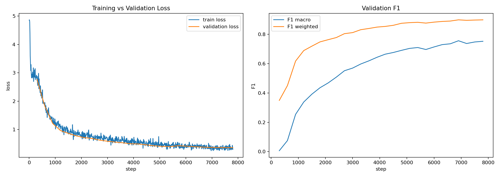

**Repeated holdouts (split seeds 42, 43, and 44)**

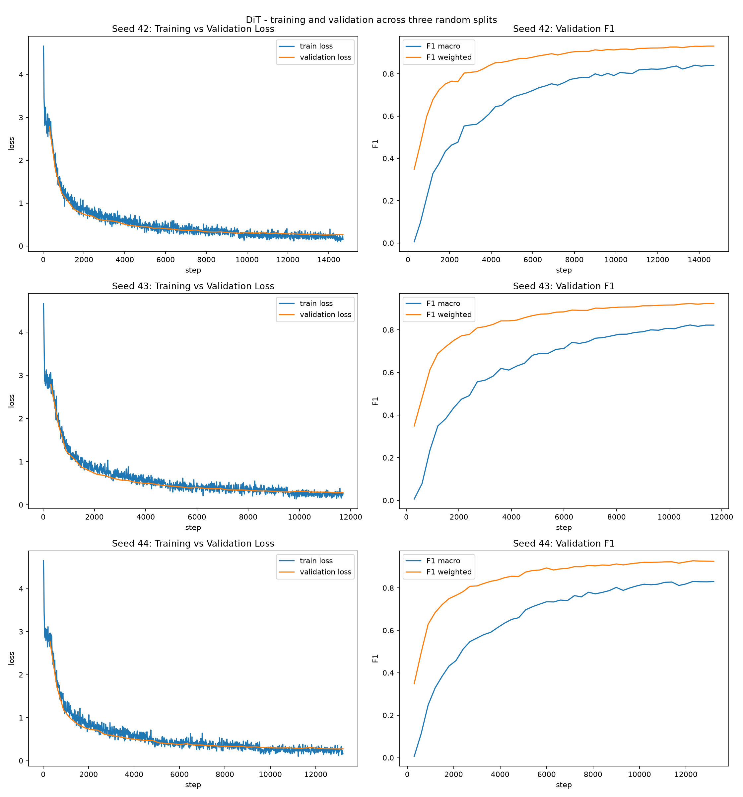

**Overall reliability**

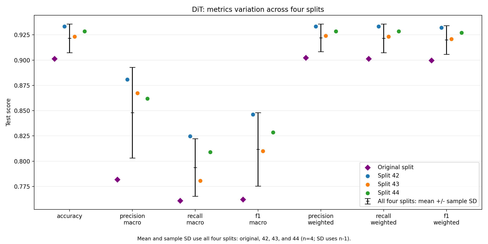

</details>

<details>
<summary>LayoutXLM</summary>

**Original split**

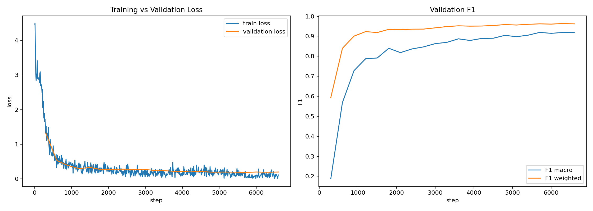

**Repeated holdouts (split seeds 42, 43, and 44)**

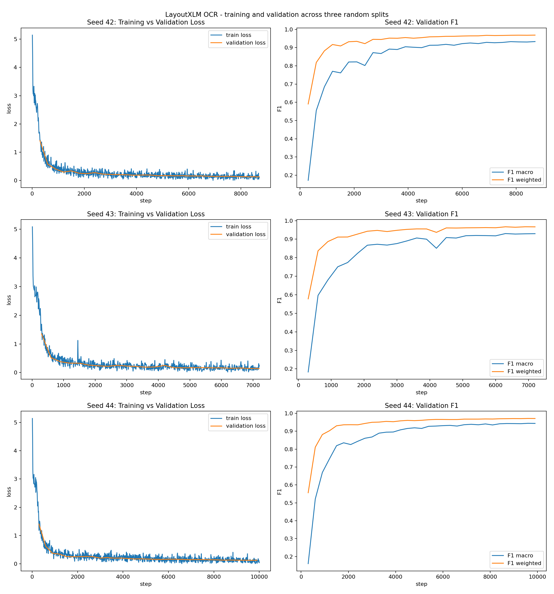

**Overall reliability**

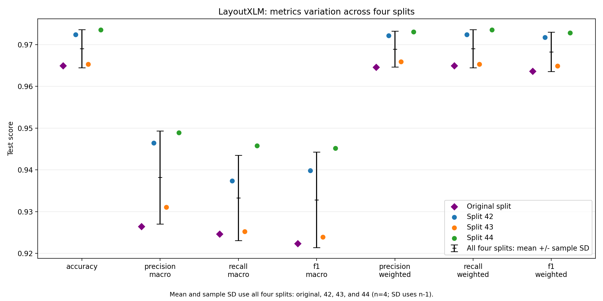

</details>

### Per-class error analysis

The heatmap shows the four classes with the lowest mean F1 across models and the four remaining classes with the largest gap between their highest and lowest model scores. Test-page counts show how many examples support each row.

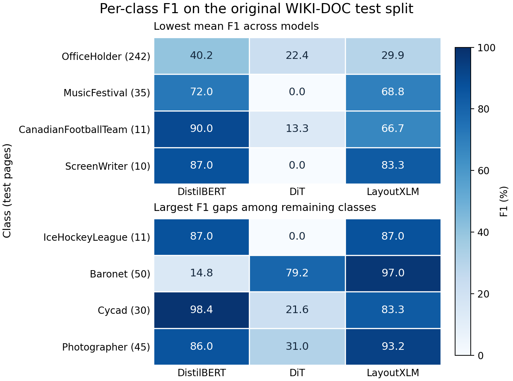

OfficeHolder was difficult for all three models, with F1 below 41% despite 242 test pages. Baronet shows a different pattern. DistilBERT scored 14.8%, DiT 79.2%, and LayoutXLM 97.0% across 50 test pages.

### Discussion

**Class imbalance.** The `Other` class accounts for 16,793 of 32,680 original test documents (51.4%). Strong performance on that class contributes heavily to weighted F1. Macro F1 gives small classes the same weight as `Other`, making class-level failures easier to see alongside the aggregate result.

**Sensitivity to document assignment.** DistilBERT's Baronet F1 rose from 14.8% on the original test split to 86.7–92.6% across the repeats. CanadianFootballTeam moved in the opposite direction, from 90.0% on the original split to zero on seeds 43 and 44, with 11 test examples per split. Class counts were fixed by design, so these comparisons show how results can change when the documents within a class change. They do not identify which document characteristics drove the changes.

**Complementarity and input limits.** DiT scored 79.2% on Baronet against DistilBERT's 14.8%, while DistilBERT scored 98.4% on Cycad against DiT's 21.6%. These class-level reversals motivate checking whether the two models make complementary errors on the same pages. OCR quality, text truncation, image resizing, and differences in model architecture can all affect the comparison.

## Current work in progress

I’m investigating when a text-first classifier benefits from using visual information, and whether those gains carry over to degraded document scans.

## Split integrity example

[Run the Python example](examples/check_splits.py) to see how a shared manifest can catch document overlap between partitions and mismatched assignments across models for the same split seed. It uses three synthetic documents and Python 3.9 or newer.

```sh
python examples/check_splits.py
```

## Reproduce the original-split F1 scores

The [per-class results CSV](results/original-split-per-class.csv) contains F1 and test-page counts for all 110 classes and each model on the original split. The [aggregation example](examples/summarize_f1.py) reproduces the original-split macro and weighted F1 values from these saved scores using Python 3.9 or newer.

```sh
python examples/summarize_f1.py
```

## Additional runnable examples

- [Compare per-class F1](examples/compare_classes.py) ranks absolute differences between two baselines using the original test results. The signed gap is the second model’s F1 minus the first model’s F1, in percentage points. A minimum test-page count lets readers inspect gaps among better-supported classes.
- [Fuse aligned probabilities](examples/fuse_probabilities.py) shows how a weighted average combines two sets of class scores after validating document IDs and class labels. The inputs are synthetic.

```sh
python examples/compare_classes.py DistilBERT DiT --min-support 50 --top 5
python examples/fuse_probabilities.py
```

### Inspect OCR on one page

[Inspect a first-page image](examples/inspect_ocr_page.py) with docTR to see the
recognized words and their pixel boxes. The script saves an overlay and JSON with
the joined text for DistilBERT and word boxes scaled to LayoutXLM's 0–1000
coordinate range. The JSON shows the input before tokenization and truncation.

```sh
python -m pip install python-doctr
python examples/inspect_ocr_page.py assets/wikidoc-samples/volcano.png --output-dir ocr-demo
```

The first run downloads pretrained docTR weights. The [saved JSON](examples/sample-data/ocr.json)
and overlay below show docTR output for `166798.png` from the English WIKI-DOC test split
(row 0 of `test-00000-of-00044.parquet`).

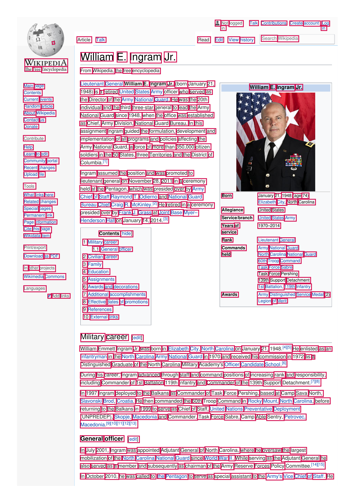

### Compare errors on the same documents

The [DistilBERT](examples/sample-data/original-test-distilbert.csv) and
[DiT](examples/sample-data/original-test-dit.csv) prediction exports cover the
same 32,680 pages from the original WIKI-DOC test split. The
[comparison script](examples/compare_document_errors.py) matches rows by
`sample_id` and checks that the ground-truth labels agree.

```sh
python examples/compare_document_errors.py examples/sample-data/original-test-distilbert.csv examples/sample-data/original-test-dit.csv
```

| Outcome | Test pages |
| --- | ---: |
| Both correct | 28,676 |
| Only DistilBERT correct | 2,542 |
| Only DiT correct | 777 |
| Both wrong | 685 |

DiT got 777 of the 1,462 pages DistilBERT missed correct (53.1%).
